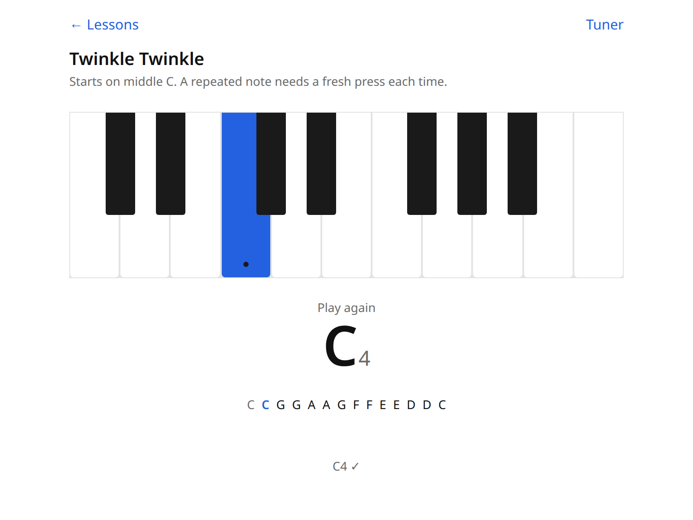

# ptute

Piano lessons that listen. Play on your real piano; ptute hears it through the microphone and lights the next key.



```sh
npm install
npm run dev      # http://localhost:5173
npm test         # note math + onset tracker (node:test)
npm run build    # tsc + vite build → dist/
```

- The microphone only works on `https://` or `localhost`.
- **Tuner** page: play any note to check it. If your piano is not at A = 440 Hz, play the A above middle C and press *Use this as A* (or type a reference between 415 and 466 Hz). The reference is stored in your browser.
- Play without the sustain pedal: detection is one note at a time, and a new note struck over one still ringing is read late.
- Nothing is recorded or sent anywhere.

The design is decided in [DESIGN.md](DESIGN.md).
